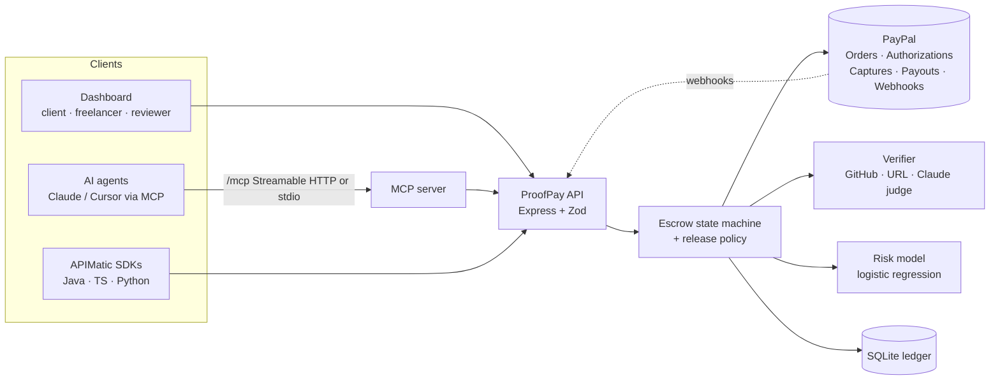

# ProofPay — pay on proof, not on promises

**Escrow for freelancers and AI agents, built on PayPal.** The client's money is held with a PayPal
authorization, every delivery is checked against the agreed criteria (merged PR, live URL, or
AI review of a document), and the payment is captured the moment it's safe — or held for a person
when it isn't. Every payment it releases leaves behind **signed proof of delivery that the freelancer
owns and anyone can verify.**

> Built for the PayPal AI Hackathon 2026. Runs fully offline out of the box (PayPal simulator +
> rules fallback) and switches to the real PayPal sandbox and Claude as soon as keys are set.

---

## The problem

Getting paid for freelance work runs on trust that often isn't there. In a widely cited Freelancers Union
survey of 5,358 freelancers (2015), **half had trouble collecting payment in a single year**, and those who
went unpaid lost **$5,968 on average — about 13% of their annual income**. Clients carry the opposite risk:
pay upfront and get nothing. Cross-border pairs — an Indian developer and a US client, say — have the
least recourse either way.

The usual fix is a marketplace that holds the money. That works, but the escrow comes bundled with the
marketplace: its fees, its rules, and a reputation you can't take with you. A new freelancer with a great
record somewhere else starts from zero. And now AI agents are starting to hire and pay for work, with
nothing to make sure money only moves when the work is real.

## What's new here

1. **Proof you own, not a rating a platform owns.** Every released milestone gets an Ed25519-signed
   attestation: what was agreed, what was delivered, which checks passed, when PayPal captured. The public
   key is at `/.well-known/jwks.json`, so anyone verifies it **without trusting ProofPay** — in their browser,
   with any JOSE library, or as evidence in a PayPal dispute. Freelancers share their whole record as one
   link; it names no one (email hashes only), and the viewer can confirm "is this you?" by typing an email.
2. **The merge button is the release button.** The freelancer submits the pull request before it's merged.
   When the maintainer merges it, GitHub's webhook triggers verification and PayPal captures the hold.
   (The webhook is only a trigger — ProofPay always re-reads the real PR state, so a forged event moves nothing.)
3. **ML decides *when*, not just *whether*.** The risk model prices the payout: low risk is paid instantly,
   higher risk waits two to seven days, and a PayPal dispute opened in that window pauses it. The platform
   never pays out money a buyer is about to claw back, and trusted pairs never wait.
4. **Agents can buy and sell, but can't move money on their own.** Two agents can run a whole job between
   them over MCP (`npm run demo:agents`), with a person approving the PayPal hold and any payment the policy
   holds. The limits live in the server and in the agent's key, not in a prompt.
5. **Both sides are protected, by rules.** The client can't cancel once work is submitted (`FREELANCER_PROTECTED`);
   a freelancer who misses the deadline can't keep the hold, and the client is never charged.

**How it compares.** Bounty platforms already pay on merge — Algora charges an 11% fee and pays contributors in
3–8 days. ProofPay keeps a 2% fee (configurable), pays low-risk work instantly through PayPal, works for any
deliverable rather than only code, and leaves the freelancer with portable proof instead of a platform profile.

## What ProofPay does

| Step | What happens | Tech |
|---|---|---|
| **Agree** | Paste a scope of work. AI splits it into milestones with amounts, deadlines and *machine-checkable* acceptance criteria. You review and edit. | Claude (structured tool output) · rules fallback |
| **Hold** | The client approves a PayPal order with `intent=AUTHORIZE`. Money is reserved, **not charged**. | PayPal Orders v2 |
| **Prove** | The freelancer submits a GitHub PR, a live URL and/or a document. A PR can be submitted before it's merged; merging it releases payment. | GitHub webhook |
| **Check** | Deterministic checks (PR merged? files touched? CI green? URL returns 2xx? page contains text?) plus AI review for subjective work, with prompt-injection defence. | GitHub API · fetch with SSRF guard · Claude |
| **Score** | A logistic-regression model scores release risk from 11 features and explains its top factors. | scikit-learn → JSON → TypeScript |
| **Decide** | All criteria pass **and** confidence ≥ 70% **and** risk < 35% → auto-release. Otherwise the money waits for the client. | Policy engine |
| **Pay** | Capture the authorization, then pay the freelancer's share with Payouts (platform fee kept). Cancel → void the hold, the client is never charged. | PayPal Payments v2 · Payouts v1 |
| **Dispute** | Freeze the milestone; AI writes a neutral evidence brief for a reviewer. | Claude |
| **Prove it later** | An Ed25519-signed attestation is issued on release. The freelancer exports their record as one link; anyone verifies it with the public key. | JWS (EdDSA) · WebCrypto |
| **Pay on time** | Payout timing follows the risk score: instant for low risk, 2–7 days otherwise, paused by a PayPal dispute. | ML risk model · scheduler |
| **Defend** | If the buyer later disputes the payment *with PayPal*, ProofPay matches it to the milestone and answers with the verification record and a signed delivery receipt. | PayPal Disputes API · webhooks |

**Agentic commerce:** the same flow is exposed as an MCP server (remote at `/mcp`, or local stdio),
so Claude, Cursor or any procurement agent can hire and pay through ProofPay. The guardrails live in
the server, not the prompt. Agents use **agent keys**, so the server knows it's an agent even if it
calls the REST API directly. A person approves every PayPal hold, and an agent can never override a
policy hold, refund, retry payouts or resolve disputes (`HUMAN_APPROVAL_REQUIRED`). When an agent creates
an escrow it never sees the person's key — the person gets their dashboard link by approving the PayPal
hold with their own login.

## Architecture



Milestone lifecycle:

```
DRAFT → AWAITING_APPROVAL → FUNDED → SUBMITTED ─┬─ fail ─→ CHANGES_REQUESTED → (resubmit)
                                                 ├─ pass, low risk ─→ RELEASED (capture + payout)
                                                 └─ pass, uncertain → NEEDS_REVIEW → RELEASED (client)
any held state → DISPUTED → RELEASED | REFUNDED (reviewer)        any unpaid state → REFUNDED (void)
```

## Run it in 2 minutes

Requires **Node 22.13+** (uses the built-in `node:sqlite`).

```bash
npm install
npm run dev            # http://localhost:8080
```

Open the app → **Try a sample scope** → **Draft milestones** → **Create escrow** → **Fund** →
approve the hold → switch to **Freelancer** → submit proof → watch it verify and pay out.
The **Ledger** tab shows every money movement; **Connect an agent** creates agent keys and shows the
MCP setup. On a released milestone in simulator mode, **Simulate a PayPal chargeback** shows the
dispute defence.

**Access:** creating an escrow gives the client and the freelancer each a private link (the key is in the
link's `#` fragment, so it never reaches server logs). In this demo the creator's browser keeps both keys
so you can switch views; in real use you send the freelancer their link. The **Reviewer** view needs the
admin key: set `ADMIN_KEY`, or copy the one printed in the server log on first start.

Watch two AI agents run a whole job through ProofPay (needs the server running):

```bash
npm run demo:agents                                         # text deliverable, works offline
npm run demo:agents -- --pr https://github.com/you/repo/pull/7  # a real pull request
```

Run the tests (34 end-to-end, unit and Claude-wiring tests, all offline):

```bash
npm test
```

Run the live LLM tests (10 cases against real Claude: plan extraction, judging good / partial /
off-topic deliverables, prompt-injection and fence-break attempts, and dispute-brief neutrality):

```bash
ANTHROPIC_API_KEY=sk-ant-... npm run test:llm      # or put the key in .env
```

Run the browser smoke test (33 checks across every screen and role, phone width and dark mode). It needs
Python Playwright and a running server in simulator mode:

```bash
pip install playwright && python -m playwright install chromium   # once
BASE_URL=http://localhost:8080 ADMIN_KEY=<reviewer key> npm run test:ui
```

LLM output varies run to run, so run it 2–3 times before trusting a prompt change. The run ends with
a report of every verdict and the tokens used.

### Use the real PayPal sandbox

1. Go to <https://developer.paypal.com> → **Apps & Credentials** → **Sandbox** → **Create App** (type: Merchant).
2. In the app's features, make sure **Payouts** is enabled.
3. Copy the client id and secret into `.env` (see `.env.example`):
   ```
   PAYPAL_CLIENT_ID=...
   PAYPAL_CLIENT_SECRET=...
   ```
4. Under **Testing Tools → Sandbox Accounts** you have a *personal* (buyer) and a *business* account.
   Use the personal account to approve holds, and its email as the freelancer's PayPal email to see the payout land.
5. GitHub (optional, for "merge = payment"): in the repository's **Settings → Webhooks**, add
   `https://<your-host>/api/webhooks/github`, content type `application/json`, a secret (also set as
   `GITHUB_WEBHOOK_SECRET`), and the events **Pull requests**, **Check suites** and **Check runs**.
6. Webhooks: add `https://<your-host>/api/webhooks/paypal` in the app's Webhooks section,
   subscribe to `CHECKOUT.ORDER.APPROVED`, `PAYMENT.AUTHORIZATION.*`, `PAYMENT.CAPTURE.*`,
   `PAYMENT.PAYOUTSBATCH.*` and `CUSTOMER.DISPUTE.*`, and set `PAYPAL_WEBHOOK_ID`. Local development needs a
   public URL (deploy to Render, or use a tunnel). To test the dispute defence for real, open a dispute from
   the sandbox buyer account in the sandbox PayPal site's Resolution Center.

The header chip switches from **PayPal simulator** to **PayPal sandbox**.

### Use Claude

Set `ANTHROPIC_API_KEY` (and optionally `ANTHROPIC_MODEL`). Claude then drafts plans, reviews
non-code deliverables and writes dispute briefs. Without a key, a deterministic parser and a
keyword judge are used, and their confidence is capped so a human always confirms.

### Deploy to Render

`render.yaml` is a Blueprint that uses only Render's **Free** plan: Render → **New → Blueprint** → pick the repo →
add your keys. `RENDER_EXTERNAL_URL` is picked up automatically for PayPal return URLs. A `Dockerfile` is included too.

Free web services sleep after 15 minutes without visitors, take about a minute to wake, and **lose the SQLite
database when they sleep or restart**. For a demo others will visit later:
- set `ATTESTATION_PRIVATE_KEY` (`npm run keygen`) so signed proofs stay verifiable after a restart;
- set `GITHUB_TOKEN` (a fine-grained token with public read access is enough) — Render's shared IPs use up
  GitHub's 60-requests-an-hour anonymous limit quickly;
- point a free uptime monitor (for example UptimeRobot, every 5 minutes) at `https://<your-app>.onrender.com/api/health`
  to keep it awake. One always-on service uses about 744 of the 750 free hours a month, so don't run other
  free services in the same workspace.

## Connect an AI agent (MCP)

**Remote:** point any MCP client that supports Streamable HTTP at `https://<your-host>/mcp`
(set `MCP_TOKEN` to require `Authorization: Bearer <token>`).

**Local (Claude Desktop / Cursor):**

```json
{
  "mcpServers": {
    "proofpay": {
      "command": "npx",
      "args": ["tsx", "/absolute/path/to/proofpay/src/mcp/stdio.ts"],
      "env": { "PROOFPAY_URL": "http://localhost:8080" }
    }
  }
}
```

Tools: `proofpay_draft_plan`, `proofpay_create_escrow`, `proofpay_get_escrow`,
`proofpay_fund_milestone`, `proofpay_submit_work`, `proofpay_verify_milestone`,
`proofpay_release_milestone`, `proofpay_request_changes`, `proofpay_open_dispute`, `proofpay_explain_risk`.
Escrow tools take an `escrowKey`: the `agentKey` returned by `proofpay_create_escrow`, or a key a person
created in the dashboard's **Connect an agent** tab.

Try: *"Hire riya@design.example to design three logo concepts for my bakery for $120, due in 5 days.
Use ProofPay so she's only paid when the concepts are delivered, then give me the approval link."*

## APIMatic

ProofPay's public API is defined in [`apimatic/src/spec/openapi.yaml`](apimatic/src/spec/openapi.yaml)
(OpenAPI 3.0, lint-clean, and a test asserts every path in it is actually served). From that one spec,
APIMatic generates the SDKs, the developer portal and the context plugin that other developers and
their AI coding assistants use to integrate with ProofPay:

```bash
npx @apimatic/cli auth login
npm run apimatic:validate
npm run apimatic:sdk:java         # also :ts and :python
npm run apimatic:portal
npx @apimatic/cli plugin generate --input=./apimatic   # context plugin for Cursor / Claude Code
```

APIMatic's MCP Server Generator (in the APIMatic dashboard) can generate a governed MCP server from the
same spec — an alternative to the hand-written one in `src/mcp`. PayPal's own official server SDKs are
APIMatic-generated, so ProofPay's SDKs follow the same conventions as the PayPal SDKs developers already use.
See [docs/APIMATIC.md](docs/APIMATIC.md). The CI workflow regenerates the TypeScript SDK on every push
when an APIMatic key is configured.

## Sponsor tools — what each one does here

| Tool | Where | What it's for |
|---|---|---|
| **APIMatic** | `apimatic/src/spec/openapi.yaml` | One OpenAPI spec → Java / TypeScript / Python SDKs, developer portal, context plugin and MCP server. A test fails if the spec and the server drift. |
| **AG Grid** | Ledger tab · Reviewer **Risk desk** (`#/desk`) | The risk desk shows every milestone across every escrow, with custom cell renderers (status pills, risk bars), sorting by risk then days left on the PayPal hold, quick search, a "needs attention" filter, highlighted rows for disputes and expiring holds, and CSV export. The ledger is the audit trail of every money movement. |
| **Bryntum Gantt** | **Timeline** tab | Plots each milestone's working time against its **PayPal hold window** (authorizations last 29 days), with deadline flags and the earliest safe funding date for unfunded work. It answers the client's real question: will the money still be held when the work lands? |
| **Render** | `render.yaml` | One-click Blueprint on the Free plan: health check, generated reviewer key in an environment group, and the hold-expiry / scheduled-payout sweep running in the service. Notes on keeping a free demo awake are in the file. |
| **Postman** | `postman/ProofPay.postman_collection.json` | Generated from the same spec. "Create escrow from scope" saves the keys and ids into collection variables, so the rest of the collection runs straight away. Checked with Newman. |
| **Zapier** | `NOTIFY_WEBHOOK_URL` | Escrow events (funded, released, held for review, disputes, expiring holds) are POSTed as JSON to a Zapier Catch Hook → Slack, email or Google Sheets. Optional HMAC signature in `X-ProofPay-Signature`. |

Bryntum is commercial software. The project installs the public **trial** package from npm
(`@bryntum/gantt-trial`, shown with a watermark) and doesn't include Bryntum code in the repository.

## The ML model

`ml/train.py` trains a release-risk classifier and exports coefficients to `src/ml/model.json`, which
the API scores natively (no Python at runtime).

- **Features (11):** milestone size, time to deadline, freelancer's completed milestones and dispute rate,
  first engagement between the pair, resubmissions, verifier confidence, share of criteria passed,
  time from funding to submission, share of subjective criteria, late submission.
- **Why logistic regression:** every money decision must be explainable. Each feature's contribution
  (coefficient × standardized value) is shown in the UI. It matches a gradient-boosting baseline
  (AUC 0.785 vs 0.780 on held-out data).
- **Honest cold start:** there is no public dataset of escrow outcomes, so v1 is trained on a synthetic
  dataset whose generating process is documented in `ml/train.py`.
- **Learning from real outcomes:** every decision logs its feature vector. Settled milestones become
  labelled examples (a dispute in ProofPay or with PayPal = bad, released cleanly = good).
  `GET /api/ml/export` downloads them, `python3 ml/train.py --real outcomes.csv` blends them with the
  synthetic prior, and `GET /api/ml/calibration` shows predicted vs actual risk by band (both admin-only).

## Security notes

- **Access keys** per escrow and role, stored only as SHA-256 hashes. A key works for one escrow and one role.
  Reviewer actions need the admin key. Agent keys carry agent restrictions in the key itself.
- Money moves only through a server-side state machine; invalid transitions return `409 INVALID_STATE`.
  One money operation runs per milestone at a time, so double clicks and webhook races can't capture twice.
- **Neither side can grab the money once the other has done their part.** The client can cancel before
  funding, or after the deadline passes with nothing delivered; once proof is submitted they must request
  changes or dispute (`403 FREELANCER_PROTECTED`). The freelancer can give the money back at any time.
- AI agents (`x-actor: agent`) cannot release held payments, refund or retry payouts (`403 HUMAN_APPROVAL_REQUIRED`).
- Freelancers can't release their own payment.
- URL verification blocks private, link-local and IPv4-mapped IPv6 addresses (SSRF), checks **every redirect hop**,
  and caps how much of a response it reads.
- Evidence URLs must be `http(s)`, so a submitted `javascript:` link can't run in the client's browser.
- Evidence and scopes are fenced as untrusted data in every Claude prompt, and can't close the fence early.
  If evidence contains text aimed at the verifier, confidence is capped at 30% whatever the model says,
  so a person must approve.
- A truncated or malformed Claude response is never acted on; ProofPay falls back to the rules engine.
- PayPal calls use `PayPal-Request-Id` for idempotent retries; webhook signatures are verified with PayPal.
- Capture and payout are separate steps; a failed payout is logged and can be retried from the dashboard
  without capturing twice.
- Expired PayPal approval links (they last about 3 hours) are re-issued automatically with a new request id.
- **PayPal holds last 29 days.** Milestones due later must be funded closer to the start (`FUND_LATER`).
  A background sweep warns 3 days before a hold expires and returns lapsed milestones to "not funded"
  instead of letting a release fail.
- **Chargebacks after release:** PayPal dispute webhooks are matched to the milestone by capture id, and
  ProofPay sends the verification record as `PROOF_OF_FULFILLMENT` evidence (once per dispute). The
  public receipt it links to is HMAC-signed and contains no emails.

**Known limits** (full list and the production path in [docs/PRODUCTION.md](docs/PRODUCTION.md)):
- Keys instead of user accounts: a person sees an escrow from the browser that holds its link.
- The money passes through the platform's PayPal account (capture, then payout). Production would use
  PayPal Multiparty with delayed disbursement, which requires approved-partner status.
- Single instance: SQLite plus an in-process lock. Render's free tier resets SQLite on redeploy.

## Project layout

```
src/
  app.ts              routes, access control, PayPal redirects, webhooks, MCP mount
  auth.ts             escrow / agent / admin keys, signed receipts
  receipt.ts          public proof-of-delivery page
  services/escrow.ts  state machine + release policy
  paypal/             REST client (Orders, Authorizations, Captures, Payouts, Webhooks) + offline simulator
  ai/                 Claude client, scope → plan extractor
  verify/             GitHub, URL and AI checks; dispute brief
  ml/                 risk model scoring, outcome export, calibration + exported model.json
  mcp/                MCP tools, Streamable HTTP and stdio transports
public/               dashboard (vanilla JS, AG Grid ledger + risk desk, Bryntum timeline)
postman/              Postman collection generated from the spec
apimatic/src/spec/    OpenAPI spec for APIMatic
ml/train.py           model training
tests/                end-to-end, unit and Claude-wiring tests; tests/llm/ live LLM evals
```

## License

MIT — see [LICENSE](LICENSE).
